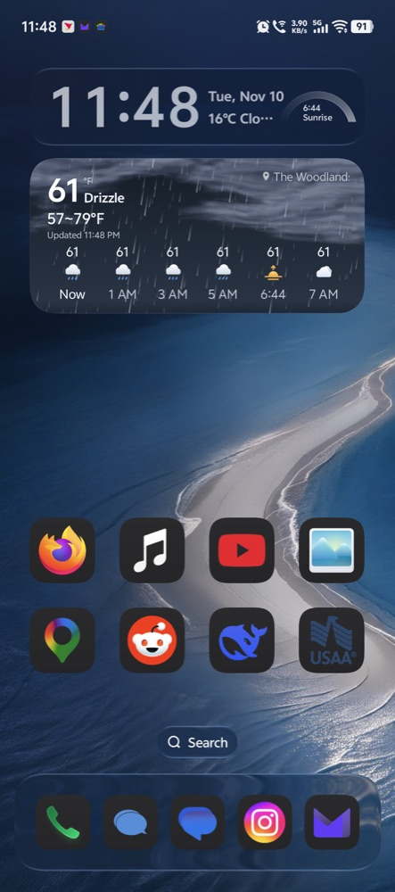

# Skyline Weather

An Android home-screen weather widget with a hand-drawn sky. The UI is a single WebView page; the
widget is rendered natively into a `RemoteViews` bitmap, so it works without opening the app.

Data comes from [Open-Meteo](https://open-meteo.com/) — no API key, no account, no tracking.

## What it does

- 4×2 resizable widget: current conditions, today's range, six-hour forecast with sunrise/sunset
  slotted in at its real time, and a sky that changes with the weather and time of day.
- Follows your location: the stored place is re-checked on every refresh and rewritten when you
  move more than ~1.5 km, reverse-geocoded to a city name.
- Refreshes every 15 minutes while the phone is awake, immediately when you unlock it, when the
  network comes back, and when you open the app.
- Exact wakeup alarms during 07:00–23:00; overnight it falls back to non-wakeup alarms so it does
  not rouse the phone (the same trade vivo's own weather widget makes).
- A foreground service keeps the refresh chain alive on devices that freeze background apps. It
  shows one silent, minimum-importance notification — that is required by Android for a foreground
  service, and it is not optional.

## Install

Download the APK from the [latest release](../../releases/latest) and install it. Android will ask
you to allow installing from unknown sources, because this is not on the Play Store.

Requires Android 8.0 (API 26) or newer; built and tested against Android 17 / API 37.

**The APK is signed with a debug key.** That is fine for sideloading, but it means anyone with the
same public debug keystore could sign an update that Android would accept. Do not treat this build
as production-signed software.

## Screenshots

| Widget (home screen) | App |
|---|---|
|  |  |

## Build

The project builds without Gradle: `aapt2` for resources, `javac` for sources, `d8`, `zipalign`
and `apksigner` from the Android build-tools.

```sh
cd android
./build.sh            # produces build/SkylineWeather.apk
./build.sh <serial>   # also installs to that adb device
```

`build.sh` expects:

- Android SDK at `~/Library/Android/sdk` with `build-tools/36.0.0` and `platforms/android-36`
- JDK 17 at `/Library/Java/JavaVirtualMachines/temurin-17.jdk/Contents/Home`
- A debug keystore at `~/.android/debug.keystore`

Adjust the paths at the top of the script for your machine.

## Permissions

| Permission | Why |
|---|---|
| `INTERNET`, `ACCESS_NETWORK_STATE` | fetching the forecast |
| `ACCESS_COARSE_LOCATION`, `ACCESS_FINE_LOCATION`, `ACCESS_BACKGROUND_LOCATION` | keeping the widget's place in step with you while it refreshes in the background |
| `RECEIVE_BOOT_COMPLETED` | re-arming the refresh chain after a reboot |
| `FOREGROUND_SERVICE`, `FOREGROUND_SERVICE_SPECIAL_USE` | the keep-alive service |
| `POST_NOTIFICATIONS` | its notification |
| `SCHEDULE_EXACT_ALARM` | the 15-minute wakeup alarm |
| `VIBRATE` | in-app feedback |

## Known limitations

- **Aggressive OEM memory management.** On a memory-tight phone the system may kill the app
  regardless of the foreground service. The persisted `JobScheduler` job restarts it within roughly
  one alarm cycle; an optional shell watchdog can shorten that to under a minute (see the release
  notes).
- **The notification cannot be swiped away.** Android marks foreground-service notifications
  `NO_CLEAR`; the app hides the status-bar icon but the shade entry stays.
- **Place names come from two geocoders.** The widget uses Android's `Geocoder`; the web UI uses
  Nominatim, so the two can disagree on the label for the same coordinates.
- No dark/light theme switch in the widget — it follows the weather and the time of day.

## Licence

No licence file is included, so the code is all rights reserved by default. Add one if you intend
to accept contributions.
